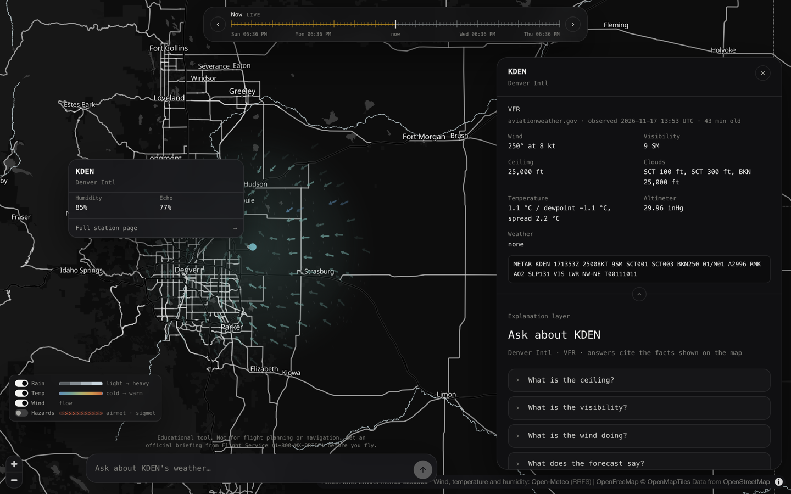
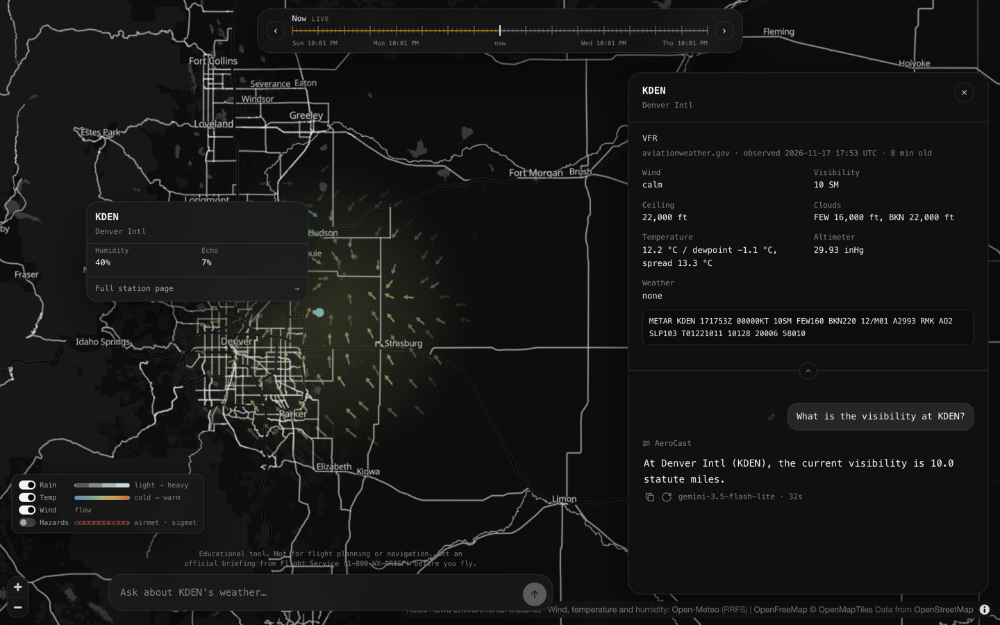
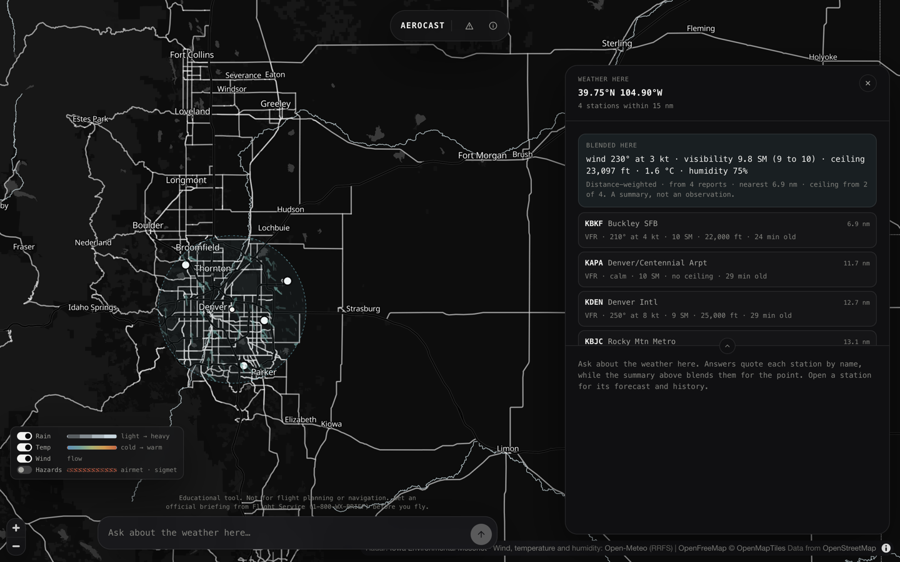
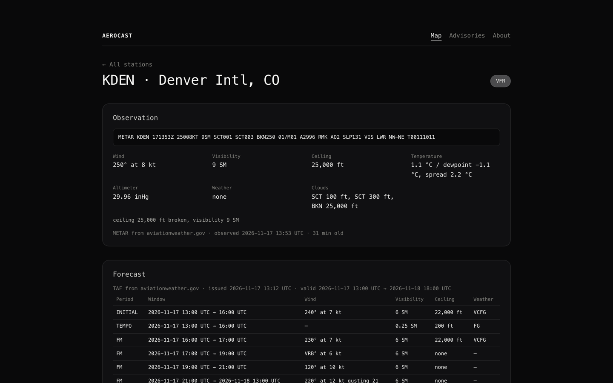
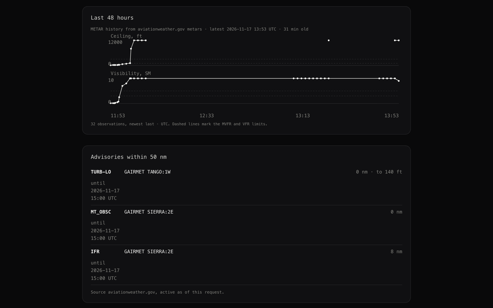

# AeroCast AI

Aviation weather you can read, with every AI sentence tied to the observation it came from.

A read-only companion to an official briefing: METAR and TAF decoded, 48 hours of history,
active advisory polygons, and a plain-English explanation layer that is only allowed to
describe facts the deterministic parser verified.

**Educational tool. Not for flight planning. Obtain an official briefing from Flight
Service (1-800-WX-BRIEF) before you fly.** AeroCast does not make go/no-go decisions and
cannot assess your aircraft, currency, or ratings.

## Screenshots

A station selected on the map: rain echo, the station card anchored above the dot, and the
explanation drawer waiting on a question.



The drawer answers in place instead of navigating away, and credits the model that
wrote it along with how long the call took.



Clicking empty ground reads the stations around that point and blends their reports for
the coordinates you picked.



The station page decodes the raw METAR beside the parsed fields, then shows the TAF as a
row per period.



Below it, the last 48 hours plotted against the MVFR and VFR limits, and the advisories
within 50 nm.



## Stack

| | |
|---|---|
| API | FastAPI, Python 3.13, SQLAlchemy + asyncpg, PostgreSQL 16 |
| Web | Remix 3.1 on Node 26.13.0 LTS, Bun for packages and scripts |
| Map | MapLibre GL JS v6 with OpenFreeMap basemap tiles |
| Weather data | aviationweather.gov (AWC Data API & cache files), IEM NEXRAD radar, Open-Meteo RRFS |
| Explanations | GroqCloud, Gemini, and OpenAI (EWMA-hedged, citation-validated, 15-minute cache) |

## Run it

Local development:

```sh
cp .env.example .env      # set DATABASE_URL and at least one model key
make install
make api                  # http://localhost:8000/api/docs
make web                  # http://localhost:44100
```

If you would rather use a containerised database than a local one:

```sh
make db                   # Postgres on localhost:5433
```

Full stack in local containers:

```sh
make up
```

Production on a single VPS (keeps Postgres and the API private, binds the web app to `127.0.0.1:44100` for Caddy, Nginx, or a Cloudflare Tunnel):

```sh
cp .env.prod.example .env # set POSTGRES_PASSWORD and at least one model key
docker compose -f compose.prod.yaml up -d --build
```

## Layout

```
backend/            FastAPI. Owns the database, parsers, ingestion, and model keys.
  app/domain/         pure logic, no IO: METAR, TAF, flight category, fact bundle
frontend/           Remix 3. Presentation plus a same-origin proxy to the API.
  app/actions/public/ browser islands: map, sketch layer, station card, search, timeline, drawer
  app/ui/public/      shared client session, icons, and fact formatters
  public/vendor/maplibre/  pinned MapLibre build, worker, and stylesheet
compose.yaml        Local container stack.
compose.prod.yaml   Hardened single-VPS container stack.
PLAN.md             Scope, schema, API surface, and safety requirements.
```

The split is deliberate: `app/domain/` has no framework imports, because the parsing is
the part that has to be right and the part that is worth reading.

The map needs network access for basemap tiles, radar, and wind grids. Everything else,
including the station list and every decoded fact, is server-rendered and works offline
against whatever is already in Postgres.

## Tests

```sh
make test    # pytest, then Remix's test runner
make lint    # ruff, ty, oxlint, oxfmt, tsc
make types   # regenerate frontend/app/lib/api-types.ts from the OpenAPI schema
make check   # full gate: hook tests, lint, tests, OpenAPI type diff, mutmut
```

Both parsers are checked against AWC's own decoder, which needs network:

```sh
make crosscheck   # writes backend/tests/golden/crosscheck*.md
```

## Commits

Conventional Commits, enforced by git hooks:

```sh
make hooks   # installs commit-msg and pre-commit
```

`commit-msg` enforces `type(scope): summary`, 72-column lines, and optional `Why:`,
`Decision:`, and `Consequences:` body sections. `pre-commit` runs `make check` with no
network or database required.

```
feat(map): add advisory polygons
fix(metar): treat P6SM as greater than six miles
refactor(llm): make the local provider runtime-agnostic
```

Types: `feat fix chore docs refactor test build ci perf style`. Git-generated
`Merge` and `Revert` commits are exempt.

## Data and attribution

- **Observations, forecasts, advisories, PIREPs**: US National Weather Service Aviation
  Weather Center ([aviationweather.gov](https://aviationweather.gov)), US Government
  public domain. AeroCast caches it and shows the observation time and fetch time with
  every value. When upstream is stale or unavailable the UI says so rather than showing a
  blank panel.
- **Radar mosaic**: [Iowa Environmental Mesonet](https://mesonet.agron.iastate.edu/ogc/)
  (NEXRAD).
- **Wind & temperature grids**: [Open-Meteo](https://open-meteo.com/) (NCEP RRFS).
- **Basemap tiles**: [OpenFreeMap](https://openfreemap.org/).
